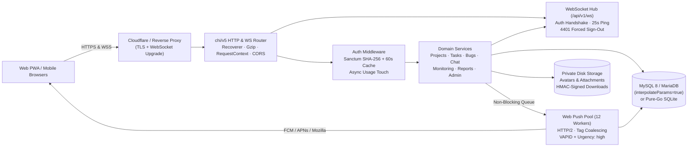

# FollowUP API (`followapi`)

High-performance, pure-Go (`CGO_ENABLED=0`) backend API, WebSocket real-time hub, and concurrent Web Push delivery service for the **FollowUP** enterprise project & team operations platform.

Designed as a zero-dependency static binary with full REST API, Sanctum Bearer token, MySQL schema, localization (`ar`/`en`), and business-logic compatibility, while adding WebSocket live updates, batched query performance, and mobile Web Push alerts.

---

## Architecture



---

## Key Engineering Highlights

- **Single Static Binary (`CGO_ENABLED=0`)**: Compiles cleanly for Linux (`amd64`/`arm64`) and Windows with zero C runtime dependencies—including an embedded pure-Go SQLite driver (`modernc.org/sqlite`) for local development and tests.
- **Laravel Sanctum & `$2y$` Bcrypt Parity**: Validates and issues `<id>|<plain>` SHA-256 hashed tokens in `personal_access_tokens`, tracks per-device `auth_sessions`, and supports `$2y$`/`$2b$` bcrypt hashes seamlessly.
- **WAN-Optimized Database Layer**: Uses MySQL `interpolateParams=true` (1 RTT per parameterized query), parallel fan-outs across dashboards/reports/chat conversations, short-TTL read-through caches with explicit write invalidation (`users`, `projects`, `advanced_settings`, auth tokens), and async throttled `last_used_at`/`last_seen_at` writes.
- **Real-Time WebSocket Hub (`/api/v1/ws`)**:
  - Token-first JSON auth handshake (`{"type":"auth","token":"..."}` within `5s`)—tokens are never placed in URLs.
  - Emits compact invalidation events (`notification`, `chat_message`, `chat_read`, `chat_changed`, `celebration`, `site_live`) so access checks stay centralized in REST handlers.
  - Closes connections immediately with custom code **`4401`** on logout, password change, session revocation, or account deactivation.
  - Sends WebSocket `Ping` frames every `25s` (`PongWait: 65s`) to keep Cloudflare and mobile links healthy.
- **Fast Mobile Web Push (`internal/push`)**:
  - **12 concurrent worker goroutines** with a shared HTTP/2 connection pool and batched `push_subscriptions` lookup (`IN (...)`) running asynchronously off the HTTP request path.
  - Bilingual (`ar`/`en`) contextual headlines, task/bug/comment/mention snippets, deep-link URLs, `tag` coalescing (`chat-<key>`, `n-<id>`), `Urgency: high` mobile wake-up, and automatic pruning on `404`/`410` push relay responses.
- **Bilingual & Timezone-Aware (`Asia/Baghdad`)**: Full Arabic (`ar`) / English (`en`) i18n error/message catalog, normalized Arabic & Latin search matching, signed HMAC download URLs for private files/avatars, and built-in Swagger UI (`/docs`).

---

## Directory Layout

```text
.
├── .github/workflows/ci.yml    # GitHub Actions CI: vet, test & cross-platform build
├── cmd/
│   ├── server/main.go          # HTTP/WS server, graceful shutdown, daily reminder ticker
│   └── cli/main.go             # Admin/ops CLI (create-ceo, set-password, deployment-check, etc.)
├── docs/
│   ├── embed.go                # //go:embed openapi.yaml
│   ├── openapi.yaml            # OpenAPI 3 specification served at /docs & /docs/openapi.yaml
│   └── schema.sql              # Full MySQL/MariaDB DDL & baseline configuration
├── internal/
│   ├── app/                    # Router wiring & end-to-end HTTP/WS integration tests
│   ├── auth/                   # Login, lockout, Sanctum tokens, session management, token cache
│   ├── ws/                     # WebSocket hub, auth timeout, pings, 4401 termination, live events
│   ├── push/                   # VAPID Web Push subscription API, 12-worker HTTP/2 pool & tests
│   ├── dbx/                    # Dual MySQL/SQLite driver, transactions, code sequence generator
│   ├── httpx/                  # Gzip middleware, rate limiters, Cloudflare IP extraction, CORS, errors
│   ├── access/                 # RBAC predicates & cached project/member/status/phase loader
│   ├── store/                  # User/team/settings models, cached user loader, JSON serializers
│   ├── advanced/               # CEO governance rules, custom roles, read-only & feature middleware
│   ├── projects/               # Projects, sprints, statuses, phases, templates & history
│   ├── tasks/                  # Tasks, dependencies, completion approvals, comments & history
│   ├── bugs/                   # Bug tracker, severity workflow & history
│   ├── chat/                   # Project, team, direct & group chats, mentions & unread tracking
│   ├── attachments/            # Multipart upload, voice metadata, HMAC-signed downloads
│   ├── avatars/                # Image upload/resize/JPEG encoding & avatar caching endpoints
│   ├── announcements/          # Company announcements & read tracking
│   ├── notifications/          # Preference-aware notifications + batch push/WS dispatch
│   ├── monitoring/             # Monitor notes, shares, triage & CEO inbox
│   ├── performance/            # Auto/manual performance metrics, review criteria & reviews
│   ├── ratings/                # Quick team & person ratings
│   ├── celebrations/           # Team celebrations & unseen tracking
│   ├── trials/                 # Trial team & evaluation tracking
│   ├── reports/                # Executive overview reports
│   ├── search/                 # Bilingual search across projects, tasks, bugs & users
│   ├── github/                 # HMAC-SHA256 webhook receiver & PR/commit linking
│   ├── admin/                  # User management, CSV/JSON bulk import, sessions, health & audit log
│   ├── reminders/              # Daily Baghdad-time overdue/due-soon/bug-late/birthday job
│   ├── audit/                  # Structured audit logger
│   ├── i18n/                   # Arabic & English localization catalog
│   └── support/                # Working-day math, Baghdad dates & normalization helpers
├── .env.example                # Environment template (copy to .env)
├── go.mod                      # Go 1.26 module definition
└── go.sum
```

---

## Tech Stack & Dependencies

- **Language**: Go `1.26.0` (`CGO_ENABLED=0`)
- **HTTP Router**: [`github.com/go-chi/chi/v5`](https://github.com/go-chi/chi)
- **WebSocket**: [`github.com/gorilla/websocket`](https://github.com/gorilla/websocket)
- **Web Push**: [`github.com/SherClockHolmes/webpush-go`](https://github.com/SherClockHolmes/webpush-go)
- **Database Drivers**: [`github.com/go-sql-driver/mysql`](https://github.com/go-sql-driver/mysql) & [`modernc.org/sqlite`](https://pkg.go.dev/modernc.org/sqlite)
- **Auth & Media**: `golang.org/x/crypto` (bcrypt), `golang.org/x/image` (avatar processing), `github.com/joho/godotenv`

---

## Quick Start

### Option A: Local Development with Zero-Dependency SQLite

```bash
cp .env.example .env
# Edit .env: set DB_CONNECTION=sqlite and DB_DATABASE=./followup.sqlite
go run ./cmd/cli create-ceo --email=ceo@company.local --password="StrongPassword123!"
go run ./cmd/server
```

On startup with `DB_CONNECTION=sqlite`, `BootstrapSQLite` automatically initializes all required tables.

### Option B: Production Setup with MySQL / MariaDB

1. **Create database & import schema**:

   ```bash
   mysql -u root -p -e "CREATE DATABASE aiicom_followup CHARACTER SET utf8mb4 COLLATE utf8mb4_unicode_ci;"
   mysql -u root -p aiicom_followup < docs/schema.sql
   ```

2. **Configure `.env`**:

   ```bash
   cp .env.example .env
   go run ./cmd/cli generate-vapid   # Paste output into VAPID_PUBLIC_KEY and VAPID_PRIVATE_KEY
   ```

   Update `DB_HOST`, `DB_PORT`, `DB_DATABASE`, `DB_USERNAME`, `DB_PASSWORD`, `APP_URL`, `APP_KEY`, `STORAGE_ROOT`, and `FRONTEND_ALLOWED_ORIGINS` inside `.env`.

3. **Create initial CEO account & verify deployment**:

   ```bash
   go run ./cmd/cli create-ceo
   go run ./cmd/cli deployment-check
   go run ./cmd/server
   ```

---

## Environment Reference

See [`.env.example`](./.env.example) for the complete template:

| Variable | Description | Default / Example |
|---|---|---|
| `APP_NAME` | Application display name | `FollowUP` |
| `APP_ENV` | Runtime environment (`production` / `local`) | `production` |
| `APP_KEY` | Secret key used for HMAC-signed attachment download URLs | `replace-with-random-app-key` |
| `APP_URL` | Public base URL (used for signed URLs & avatar links) | `https://api.example.com` |
| `PORT` | HTTP/WebSocket listen port | `8080` |
| `APP_WORKING_TIMEZONE` | Company working timezone | `Asia/Baghdad` |
| `APP_SWAGGER_ENABLED` | Serve Swagger UI at `/docs` and spec at `/docs/openapi.yaml` | `true` |
| `DB_CONNECTION` | `mysql` or `sqlite` | `mysql` |
| `DB_HOST`, `DB_PORT`, `DB_DATABASE`, `DB_USERNAME`, `DB_PASSWORD` | Database connection parameters | `127.0.0.1:3306` |
| `FRONTEND_ALLOWED_ORIGINS` | Comma-separated exact CORS & WebSocket origins | `https://follow.ama8.uk,http://localhost:3000` |
| `FRONTEND_ALLOWED_ORIGIN_PATTERNS` | Comma-separated regex patterns for preview origins | `""` |
| `TRUSTED_PROXY_CIDRS` | Additional proxy CIDRs trusted for `CF-Connecting-IP` / `X-Forwarded-For` | Cloudflare CIDRs built-in |
| `STORAGE_ROOT` | Directory for uploaded attachments, voice notes & avatars | `./storage/app` |
| `GITHUB_WEBHOOK_SECRET` | HMAC-SHA256 secret for `POST /api/v1/webhooks/github` | `""` |
| `VAPID_SUBJECT`, `VAPID_PUBLIC_KEY`, `VAPID_PRIVATE_KEY` | ES256 VAPID identity & keys for Web Push | Generate via `generate-vapid` |
| `RATE_LIMIT_LOGIN`, `RATE_LIMIT_API` | Requests/minute per IP (login) and per user (API) | `30`, `300` |
| `ENABLE_DAILY_SCHEDULER` | Run in-process reminder job after 08:00 `Asia/Baghdad` | `false` |

---

## Operations CLI (`cmd/cli`)

```bash
go build -o bin/followapi-cli ./cmd/cli

./bin/followapi-cli create-ceo             # Interactive CEO creation (min 12-char password)
./bin/followapi-cli set-password <email>   # Reset password & revoke active tokens/sessions
./bin/followapi-cli send-daily-reminders   # Run reminders manually (--day=YYYY-MM-DD optional)
./bin/followapi-cli deployment-check       # Verify DB, 31 tables, storage permissions & VAPID keys
./bin/followapi-cli generate-vapid         # Generate ES256 VAPID_PUBLIC_KEY / VAPID_PRIVATE_KEY
```

---

## API & Realtime Endpoints

- **Health Check**: `GET /up` -> `200 {"ok":true}`
- **API Docs**: `GET /docs` (Swagger UI) & `GET /docs/openapi.yaml`
- **REST API Base**: `/api/v1/*` (Bearer token auth via `Authorization: Bearer <id>|<secret>`)
- **WebSocket**: `GET /api/v1/ws`
  - First frame within `5s`: `{"type":"auth","token":"<sanctum-token>"}`
  - Unauthorized/expired/revoked close code: `4401`
  - Server events: `notification`, `chat_message`, `chat_read`, `chat_changed`, `celebration`, `site_live`

---

## Testing & Building

Run the full test suite and static analyzer (runs offline against isolated in-memory SQLite):

```bash
CGO_ENABLED=0 go vet ./...
CGO_ENABLED=0 go test -v ./...
```

Cross-compile standalone production binaries:

```bash
# Linux x86_64
GOOS=linux GOARCH=amd64 CGO_ENABLED=0 go build -o bin/followapi-linux-amd64 ./cmd/server
GOOS=linux GOARCH=amd64 CGO_ENABLED=0 go build -o bin/followapi-cli-linux-amd64 ./cmd/cli
```

```powershell
# Windows x86_64
$env:CGO_ENABLED="0"
go build -o bin/followapi.exe ./cmd/server
go build -o bin/followapi-cli.exe ./cmd/cli
```

---

## Production Reverse Proxy Notes

- Forward `Upgrade: websocket` and `Connection: Upgrade` headers to `/api/v1/ws` with an idle timeout `>= 100s` (Cloudflare proxy compatible).
- Set `APP_URL` to your external `https://` origin so signed download links and avatar URLs match browser security policies (including Web Push icons on iOS/Android).
- Never commit `.env`, `storage/`, `bin/`, or database files—all are excluded in [`.gitignore`](./.gitignore).
